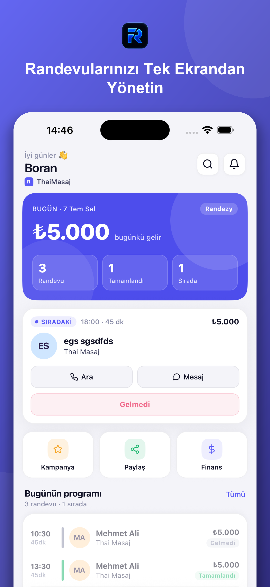
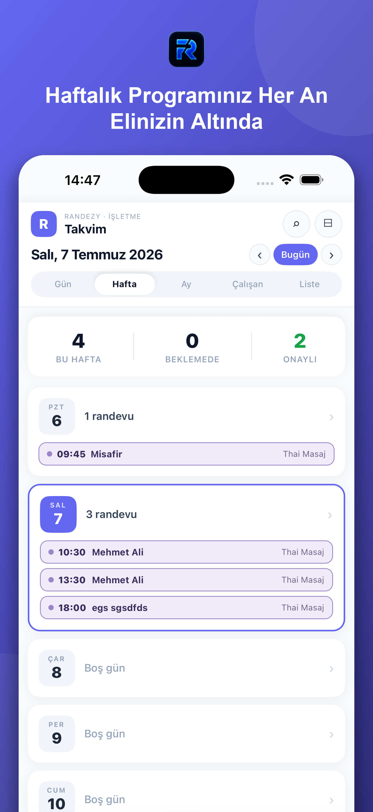
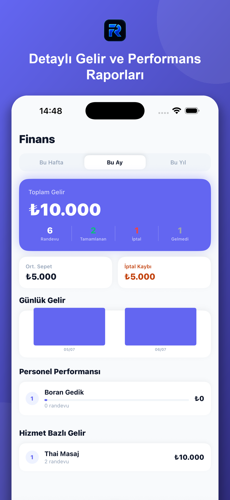
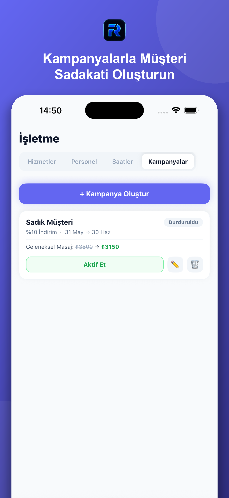
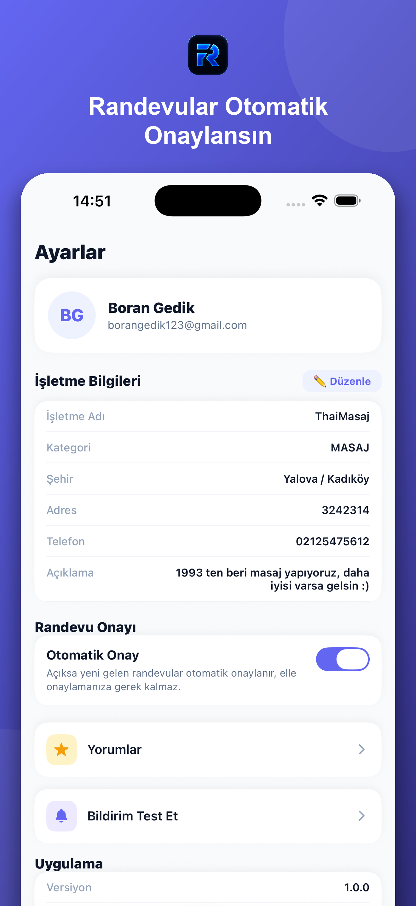

<div align="center">


# Randezy

**Kuaför, berber, güzellik merkezi, spa ve masaj salonları için online randevu ve işletme yönetim platformu**

Müşteriler bölgelerindeki işletmeleri keşfedip 7/24 online randevu alır;
işletme sahipleri takvimlerini, personellerini, kampanyalarını ve gelirlerini web panelinden ve **Randezy İşletme** mobil uygulamasından yönetir.


</div>

---

## İçindekiler

- [Randezy İşletme Mobil Uygulaması](#-randezy-i̇şletme-mobil-uygulaması)
- [Web Platformu](#-web-platformu)
- [Mimari](#-mimari)
- [Proje Yapısı](#-proje-yapısı)
- [Teknolojiler](#-teknolojiler)
- [Kurulum](#-kurulum)
- [Güvenlik](#-güvenlik)

---

## 📱 Randezy İşletme Mobil Uygulaması

**Randezy İşletme**, işletme sahiplerinin ve personelin salonu cebinden yönetmesi için geliştirilmiş iOS ve Android uygulamasıdır. Expo (React Native) ile yazılmıştır ve web paneliyle aynı Supabase veritabanını kullanır; yapılan her değişiklik iki tarafta da anında görünür.

<table>
  <tr>
    <td align="center" width="20%"></td>
    <td align="center" width="20%"></td>
    <td align="center" width="20%"></td>
    <td align="center" width="20%"></td>
    <td align="center" width="20%"></td>
  </tr>
  <tr>
    <td align="center"><b>Ana Sayfa</b><br/><sub>Günün özeti</sub></td>
    <td align="center"><b>Takvim</b><br/><sub>Haftalık program</sub></td>
    <td align="center"><b>Finans</b><br/><sub>Gelir raporları</sub></td>
    <td align="center"><b>Kampanyalar</b><br/><sub>Müşteri sadakati</sub></td>
    <td align="center"><b>Ayarlar</b><br/><sub>Otomatik onay</sub></td>
  </tr>
</table>

### Öne Çıkan Özellikler

| | Özellik | Açıklama |
|---|---|---|
| 🏠 | **Ana Sayfa** | Bugünkü gelir, toplam / tamamlanan / sıradaki randevu sayıları, sıradaki müşteri kartı (Ara, Mesaj, Gelmedi işaretle) ve günün programı |
| 📅 | **Takvim** | Gün, Hafta, Ay, Çalışan ve Liste görünümleri; haftalık özet (bu hafta / beklemede / onaylı), anlık saat göstergesi, personel filtresi ve randevu arama |
| ➕ | **Hızlı Randevu** | Alt menüdeki ortadaki butonla walk-in (kapıdan gelen) müşteri dahil saniyeler içinde yeni randevu oluşturma; randevuya ek hizmet ve ürün ekleme |
| 💰 | **Finans** | Haftalık / aylık / yıllık toplam gelir, tamamlanan, iptal ve gelmedi sayıları, ortalama sepet, iptal kaybı, günlük gelir grafiği, personel performansı ve hizmet bazlı gelir |
| 🏪 | **İşletme Yönetimi** | Hizmetler, personel, çalışma saatleri ve kampanyaların tek ekrandan yönetimi |
| 🎯 | **Kampanyalar** | Yüzdelik indirim kampanyaları oluşturma, tarih aralığı belirleme, indirimli fiyat önizleme, kampanyayı aktif etme / durdurma |
| ✅ | **Otomatik Onay** | Açıldığında yeni gelen randevular otomatik onaylanır, elle onaylamaya gerek kalmaz |
| ⭐ | **Yorumlar** | İşletmeye gelen müşteri yorumlarını görüntüleme |
| 🔔 | **Anlık Bildirimler** | Yeni randevu ve durum değişikliklerinde push bildirimi (Expo Notifications) |
| 👥 | **Personel Girişi** | Personel, işletmenin verdiği erişim koduyla giriş yapıp yalnızca kendi takvimini görür |
| 🍎 | **Apple ile Giriş** | E-posta / şifrenin yanında Apple ile giriş desteği |

### Uygulama Ekranları

```
mobile/screens/
├── LoginScreen.tsx          → İşletme sahibi girişi (e-posta, Apple)
├── StaffLoginScreen.tsx     → Personel erişim kodu ile giriş
├── StaffCalendarScreen.tsx  → Personelin kendi takvimi
├── HomeScreen.tsx           → Günün özeti ve programı
├── CalendarScreen.tsx       → Gün / Hafta / Ay / Çalışan / Liste görünümleri
├── AppointmentsScreen.tsx   → Randevu listesi
├── FinanceScreen.tsx        → Gelir ve performans raporları
├── BusinessScreen.tsx       → Hizmetler, Personel, Saatler, Kampanyalar
├── ReviewsScreen.tsx        → Müşteri yorumları
└── SettingsScreen.tsx       → İşletme bilgileri, otomatik onay, bildirimler
```

---

## 🌐 Web Platformu

Next.js ile geliştirilmiş web uygulaması hem müşterilere hem de işletme sahiplerine hizmet verir.

### Müşteri Tarafı
- **İşletme keşfi** — isim, kategori, şehir ve ilçeye göre arama ve filtreleme
- **İşletme sayfası** — hizmetler, fiyatlar, örnek fotoğraflar, çalışma saatleri, konum ve Google yorumları
- **Online randevu** — hizmet, personel, tarih ve saat seçerek randevu; üyeliksiz (misafir) randevu desteği
- **Randevularım** ve **Hesabım** sayfaları
- **Hediye kartı** ve promosyon kodları

### İşletme Sahibi Tarafı
- **`/pro`** — işletmelere yönelik tanıtım ve fiyatlandırma sayfası
- **`/isletme-ekle`** — 4 adımlı işletme kayıt akışı (bilgiler → yasal bilgiler → hizmet menüsü → çalışma saatleri)
- **`/dashboard`** — randevu, hizmet, personel, çalışma saati, kampanya ve işletme bilgisi yönetimi
- **`/b/[slug]`** — işletmeye özel paylaşılabilir randevu bağlantısı
- **Abonelik** — Stripe ile ödeme ve abonelik yönetimi
- **Bildirimler** — e-posta (Resend) ile randevu hatırlatma, SMS (Netgsm) ile randevu durum bildirimi

### Desteklenen Kategoriler
Kuaför · Berber · Güzellik Merkezi · Tırnak · Fizyoterapi · Kaş ve Kirpik · Masaj · Dövme

---

## 🏗 Mimari

```
  ┌──────────────────────┐        ┌──────────────────────────┐
  │   Web (Next.js 16)   │        │ Randezy İşletme (Expo 54) │
  │  Müşteri + İşletme   │        │   iOS / Android uygulama  │
  └─────┬──────────┬─────┘        └─────┬──────────────┬─────┘
        │          │                    │              │
        │   ┌──────▼────────────────────▼──┐           │
        │   │  Supabase                    │           │
        │   │  Auth · PostgreSQL · Storage │◄──────────┘
        │   │  RLS politikaları            │
        │   └──────────────▲───────────────┘
        │                  │
  ┌─────▼──────────────────┴─────┐
  │  Next.js API Routes          │   Stripe · Resend · Netgsm
  │  + FastAPI Backend (Vercel)  │   Google Places · Expo Push
  └──────────────────────────────┘
```

- **Supabase**, kimlik doğrulama, veritabanı ve dosya depolamanın merkezidir. Tüm tablolarda Row Level Security aktiftir.
- **Next.js API route'ları** bildirim, ödeme, hatırlatma (cron), personel girişi ve yönetim işlemlerini sunucu tarafında yürütür.
- **FastAPI backend** randevu, işletme ve kullanıcı uç noktaları ile push bildirim ve e-posta gönderimini sağlar.

---

## 📂 Proje Yapısı

```
randezy/
├── frontend/      → Next.js 16 web uygulaması (App Router)
│   ├── app/       → Sayfalar ve API route'ları
│   ├── components/
│   └── lib/
├── mobile/        → Randezy İşletme — Expo / React Native uygulaması
│   ├── screens/
│   ├── components/   (calendar, modals)
│   ├── contexts/ hooks/ services/ lib/
│   └── store-assets/ → App Store / Play Store görselleri
├── backend/       → FastAPI servisi (routers, alembic, testler)
└── supabase/      → SQL migration'ları ve RLS politikaları
```

---

## 🧰 Teknolojiler

| Katman | Teknolojiler |
|---|---|
| **Mobil** | Expo SDK 54, React Native 0.81, React 19, TypeScript, React Navigation 7, Expo Notifications, Apple Authentication |
| **Web** | Next.js 16, React 19, TypeScript, Tailwind CSS 4, TanStack Query, React Hook Form + Zod, Motion, Lucide |
| **Backend** | FastAPI, SQLAlchemy, Alembic, Pydantic, python-jose, Pytest |
| **Veri & Altyapı** | Supabase (Auth, PostgreSQL, Storage), Vercel, EAS Build |
| **Entegrasyonlar** | Stripe, Resend, Netgsm, Google Places, Expo Push |

---

## 🚀 Kurulum

### Gereksinimler
- Node.js 18+
- Python 3.11+ (backend için)
- Bir Supabase projesi
- Mobil için Expo hesabı ve [EAS CLI](https://docs.expo.dev/build/setup/)

### 1. Veritabanı

`supabase/` klasöründeki SQL dosyalarını Supabase SQL Editor üzerinden çalıştırın (`rls_policies.sql` dahil).

### 2. Web (frontend)

`frontend/.env.local` dosyası oluşturun:

```env
NEXT_PUBLIC_SUPABASE_URL=
NEXT_PUBLIC_SUPABASE_ANON_KEY=
NEXT_PUBLIC_API_URL=
SUPABASE_SERVICE_ROLE_KEY=

# İsteğe bağlı entegrasyonlar
RESEND_API_KEY=
STRIPE_SECRET_KEY=
STRIPE_PRICE_ID=
STRIPE_WEBHOOK_SECRET=
GOOGLE_PLACES_API_KEY=
NETGSM_USERCODE=
NETGSM_PASSWORD=
NETGSM_HEADER=
CRON_SECRET=
ADMIN_EMAILS=
SITE_OPEN=1
```

```bash
cd frontend
npm install
npm run dev        # http://localhost:3000
```

> **Not:** Site şu anda varsayılan olarak kapalı moddadır. Yerelde ya da canlıda açmak için `SITE_OPEN=1` ortam değişkenini tanımlayın (ayrıntı: `frontend/proxy.ts`).

### 3. Mobil uygulama

Bağlantı ayarları `mobile/config.ts` içindedir.

```bash
cd mobile
npm install
npx expo start             # Geliştirme sunucusu
npm run ios                # iOS (development build)
npm run android            # Android (development build)
```

Mağaza derlemesi için:

```bash
eas build --platform ios       # veya android
```

### 4. Backend

```bash
cd backend
pip install -r requirements.txt
uvicorn main:app --reload --port 8000
pytest                         # testler
```

---

## 🔒 Güvenlik

- Tüm Supabase tablolarında **RLS** aktif
- `/api/notify` kimlik doğrulama ve `appointmentId` gerektirir; veriler doğrudan veritabanından okunur
- `/api/cron/reminders` yalnızca `CRON_SECRET` ile çalışır
- Storage bucket'ında yalnızca yükleme (INSERT) izni vardır
- KVKK, kullanıcı sözleşmesi ve ticari ileti onayları kayıt altına alınır

---

<div align="center">
<sub>Randezy — Randevularınızı tek ekrandan yönetin.</sub>
</div>
